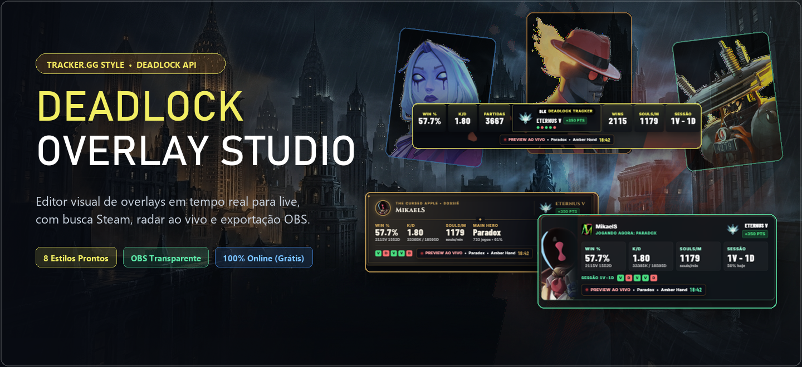
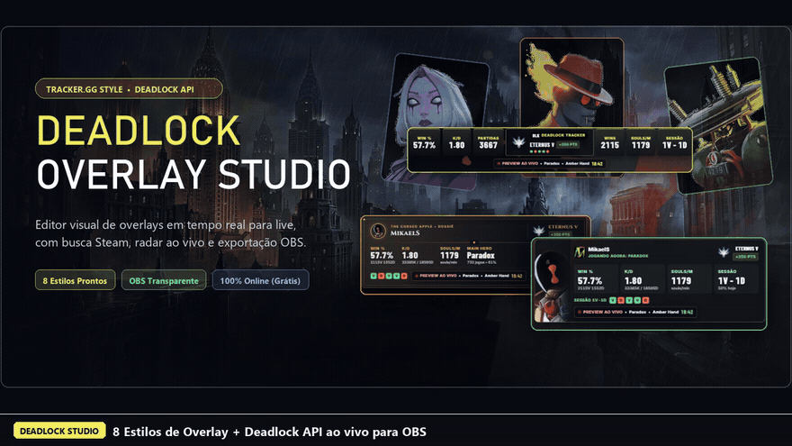
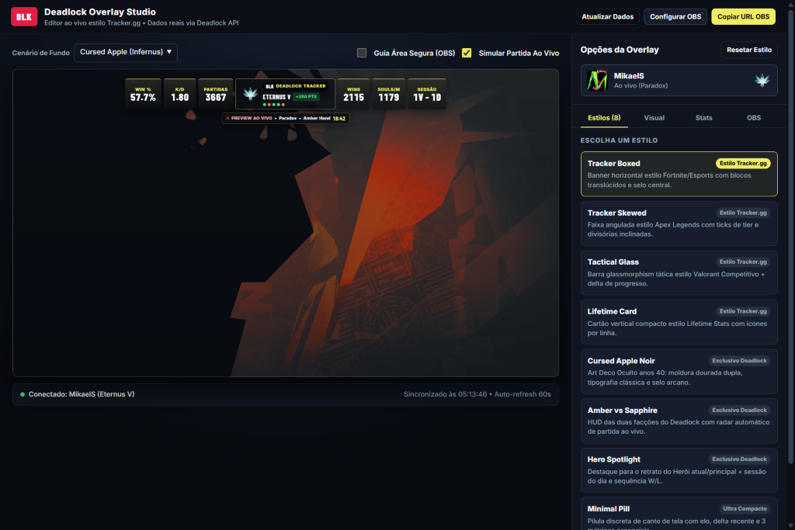
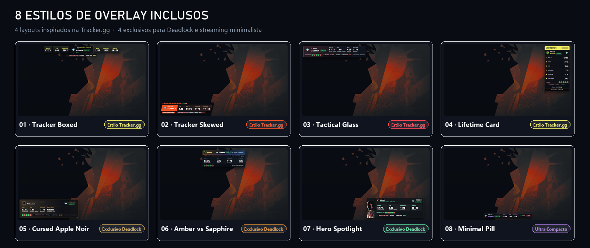
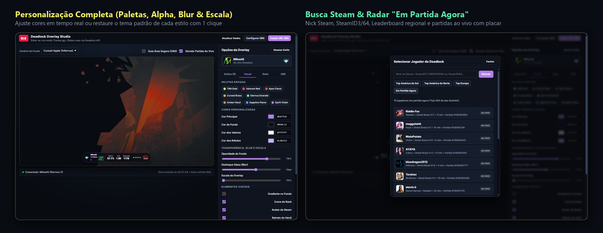

<div align="center">



<br><br>

[](https://eduardocoura.github.io/deadlock-overlay-studio/)
[](#8-estilos-inclusos)
[](#como-usar-no-obs-studio)
[](https://deadlock-api.com/)

<h3>Editor visual de overlays para Deadlock inspirado na Tracker.gg — 100% online, personalizável em tempo real e pronto para o OBS Studio.</h3>

[**Abrir Editor Online**](https://eduardocoura.github.io/deadlock-overlay-studio/) · [**Ver Estilos**](#8-estilos-inclusos) · [**Tutorial OBS**](#como-usar-no-obs-studio) · [**Vídeo em MP4**](./docs/media/demo-showcase.mp4)

</div>

---

## Demonstração em Vídeo

<div align="center">



*Troca instantânea entre os 8 estilos, personalização visual em tempo real e radar de partidas ao vivo • [Baixar / assistir versão MP4 (720p)](./docs/media/demo-showcase.mp4)*

</div>

---

## Interface do Studio

Assim como no editor da Tracker.gg, você configura tudo vendo o resultado em tempo real sobre um canvas `16:9` (com opção de fundo de arte do Deadlock, grade transparente do OBS ou Chroma Key Verde):

<div align="center">
  
</div>

---

## 8 Estilos Inclusos

<div align="center">
  
</div>

| # | Estilo | Categoria | Destaque Visual |
| :-: | :--- | :--- | :--- |
| **01** | **Tracker Boxed** | `Estilo Tracker.gg` | Banner horizontal estilo Fortnite/Esports com blocos translúcidos, selo central e borda superior destacada. |
| **02** | **Tracker Skewed** | `Estilo Tracker.gg` | Faixa angulada estilo Apex Legends com 11 ticks de progressão de tier no topo e divisórias inclinadas. |
| **03** | **Tactical Glass** | `Estilo Tracker.gg` | Barra glassmorphism tática estilo Valorant Competitivo com emblema de rank, delta de pontos e sub-rótulos. |
| **04** | **Lifetime Card** | `Estilo Tracker.gg` | Cartão vertical compacto estilo Lifetime Stats com ícones por métrica e divisórias limpas. |
| **05** | **Cursed Apple Noir** | `Exclusivo Deadlock` | Art Deco Oculto anos 40 com moldura dupla dourada, ornamentos e fonte serifada clássica. |
| **06** | **Amber vs Sapphire** | `Exclusivo Deadlock` | HUD nas cores das duas facções do Deadlock com barra comparativa de **Souls** ou rounds de **Street Brawl** ao vivo. |
| **07** | **Hero Spotlight** | `Exclusivo Deadlock` | Retrato integrado do herói principal ou em partida, placar da sessão de hoje (`12h`) e sequência `V`/`D`. |
| **08** | **Minimal Pill** | `Ultra Compacto` | Pílula discreta de canto de tela com rank, delta recente, 3 métricas essenciais e timer ao vivo. |

---

## Personalização, Busca Steam & Radar Ao Vivo

<div align="center">
  
</div>

### Recursos Principais
- **Paletas Rápidas & Cores Livres**: 8 temas prontos (`TRN Gold`, `Valorant Red`, `Apex Flame`, `Cursed Brass`, `Eternus Emerald`, `Amber Hand`, `Sapphire Flame`, `Spirit Violet`) ou pickers hex individuais com ajuste de **opacidade (até 0% transparente)**, **blur glass**, **gradiente** e **escala (`70%`–`140%`)**.
- **Construtor Modular de Stats**: adicione, remova e reordene até 8 métricas (`Win %`, `K/D`, `KDA`, `W/L`, `Partidas`, `Souls/min`, `Dano/min`, `Precisão %`, `Sessão 12h`, `Herói Principal`, `Última Partida`).
- **Filtros do Deadlock**: alterne entre **Geral**, **Normal / Ranked** ou **Street Brawl**, e escolha a janela de cálculo (**Carreira**, **Últimas 20 Partidas** ou **Sessão de Hoje 12h**).
- **Busca Multi-Formato**: encontre sua conta por **Nick da Steam**, **SteamID3**, **SteamID64**, link do perfil Steam ou navegue pelos **Leaderboards (SA / NA / Europa)** e lista **Em Partida Agora**.
- **Relógio Ao Vivo Segundo a Segundo**: quando uma partida ativa é detectada pela API, o cronômetro `MM:SS` atualiza todo segundo sem recarregar a página, exibindo placar de Souls (Normal/Ranked) ou placar de rounds (Street Brawl).

> **Sobre detecção de partidas ao vivo:** o endpoint público `/v1/matches/active` da Deadlock API acompanha as **Top 200 partidas** da aba Assistir (*Watch*) do jogo. Caso uma partida esteja fora desse Top 200, a overlay continua exibindo normalmente seu rank, métricas, sessão de hoje e últimas partidas até o término do jogo.

---

## Como usar no OBS Studio

Não precisa baixar nem instalar nada — funciona direto pelo link online:

1. Acesse **[https://eduardocoura.github.io/deadlock-overlay-studio/](https://eduardocoura.github.io/deadlock-overlay-studio/)**.
2. Clique no card do jogador no topo direito e selecione sua conta Steam.
3. Escolha o estilo, cores, posição na tela (`Topo`/`Base` — `Esq.`/`Centro`/`Dir.`) e métricas desejadas.
4. Clique em **Copiar URL OBS** (`?obs=1&...`).
5. No **OBS Studio**, adicione uma fonte **Navegador (Browser Source)** com:
   - **URL:** cole o link copiado
   - **Largura:** `1920`
   - **Altura:** `1080`
6. *(Opcional)* Se preferir rodar como arquivo offline no OBS, abra **Configurar OBS** e clique em **Baixar `deadlock-overlay-obs.html`** para carregar como **Arquivo local**.

---

## Estrutura do Projeto

```text
deadlock-overlay-studio/
├── index.html               # Interface do Studio + runtime transparente (?obs=1)
├── styles/
│   ├── studio.css           # Layout do editor e regras de transparência OBS
│   └── overlays.css         # Os 8 estilos de overlay e responsividade
├── js/
│   ├── config.js            # Presets, paletas, catálogo de stats e serialização via URL
│   ├── deadlock-api.js      # Cliente Deadlock API (CORS, retries, fallback 429, agregação)
│   ├── overlay-renderer.js  # Motor de renderização DOM seguro e relógio em tempo real
│   ├── exporter.js          # Gerador de arquivo HTML standalone para OBS
│   └── app.js               # Controlador do editor, modais e auto-refresh
├── docs/media/              # Banner, galeria de estilos, GIF e vídeo MP4 do projeto
└── server.mjs               # Servidor estático opcional para desenvolvimento local
```

## Créditos
- Dados de jogadores, ranks, partidas ao vivo e retratos oficiais de heróis fornecidos pela API aberta **[deadlock-api.com](https://deadlock-api.com/)**.
